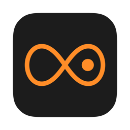

<p align="center"></p>

# Drones

A minimal macOS app: the 12 keys on a circle of fifths, each a low sustained drone. Click a key (or move with the arrow keys and press space) to play it; click another to switch; click the lit key to stop.

## Build

Needs the Xcode Command Line Tools only.

```sh
./build.sh && open build/Drones.app
```

The app is unsigned and built locally.

## License

[GPL-3.0](LICENSE)
